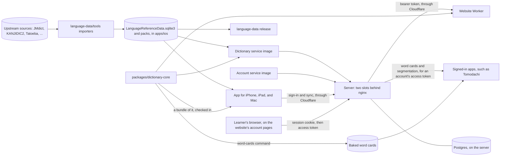

# Architecture

A map of the repository's parts, how data moves between them, and the rules that keep each part's
layers apart. Each part's own doc has the detail; each rule here is enforced by a check.

## Parts

| Part | What it is | Its doc |
| --- | --- | --- |
| `apps/ios` | The Zenbu Japanese app, in SwiftUI, built from one target for iPhone, iPad, and the Mac (ADR 0015), with a share-sheet extension on iPhone and iPad (ADR 0017). It reads the language data bundled with it, which the importers in `language-data/tools` build, answers every dictionary screen with the shared core, which it runs in JavaScriptCore, and signs in to the account service to sync known words, lists, watch history, bookmarked translations, and the profile's name and username. Its Shortcuts actions open it with links in its own scheme. `apps/ios/Tools/TranslateReplay` replays recorded Translate audio on a Mac. | [`docs/agents/ios.md`](docs/agents/ios.md) |
| `apps/web` | zenbujapanese.com: Next.js on Cloudflare Workers through OpenNext. Its dictionary pages read the dictionary service; its account pages call the account service from the learner's browser. | [`docs/agents/web.md`](docs/agents/web.md) |
| `apps/dictionary-api` | The dictionary service: Node, in a Docker image on serpcompany's server, answering the website's dictionary requests by running the shared core on the app's language data. | [`docs/agents/dictionary-api.md`](docs/agents/dictionary-api.md) |
| `apps/account-api` | The account service: Node and Postgres on the same server, for Zenbu accounts, sign-in, and sync (ADR 0013). It signs learners in with Apple, Google, or an emailed code, through Better Auth, and issues the access tokens other services check. | [`docs/agents/account-api.md`](docs/agents/account-api.md) |
| `packages/dictionary-core` | The shared TypeScript core: search, results, word and kanji detail, and examples. The service and the app both run all of it; the browser extension is to run it too (ADR 0008). | [`docs/agents/dictionary-core.md`](docs/agents/dictionary-core.md) |
| `packages/node-service` | What the two Node services share: JSON-line logs, the request log, a server that stops cleanly, and the writer of their API references (`docs/api/`). | [`docs/agents/dictionary-api.md`](docs/agents/dictionary-api.md), Code layout |
| `deploy` | The API servers' deployer, which swaps each service's signed image into its slots, and can tell a Slack channel what it deployed and what failed. Its tests are in `tools/checks/src/deployer/`. | [`docs/agents/api-servers.md`](docs/agents/api-servers.md), [`docs/agents/deployer-alerts.md`](docs/agents/deployer-alerts.md) |
| `language-data` | What every client's language data comes from: the pinned sources, the importers that build the app's bundled data from them, the conformance suites every client passes, and the release, with the pipeline that packages and publishes that data as a versioned artifact (ADR 0006). | [`language-data/README.md`](language-data/README.md) |
| `tools/checks` | The repository-wide checks behind `pnpm verify`, the script that hands each checkout its local ports, and the tests of what has no package of its own: the workflows and the server's deployer. | [`docs/agents/code.md`](docs/agents/code.md) |

## How data moves

The app's bundled data is the one source: the importers build it, the app bundles it, the service's
image copies it, and the release packages it. Each release's manifest is pinned in
`language-data/releases/`, and checks before merge hold the app's files and the image's copies to
it ([`language-data/README.md`](language-data/README.md), Pinned releases). Each release also
records the JMdict entries it retires, in a file the pipeline writes and the app doesn't bundle,
which the service answers the website's retired word URLs from
([`language-data/retired-entries.md`](language-data/retired-entries.md)). The website reads no data of its own; it asks the
service, which runs the same core the website renders with. The app answers its dictionary
screens with that core too, from a bundle of it checked in beside the data, so it shows what the
website shows with no network ([`docs/agents/ios.md`](docs/agents/ios.md), The dictionary core in the app). A new build of the data is a new
service image; the site redeploys after it only to write the dictionary's sitemaps from it, on the
CI runner (ADR 0016). An app that doesn't bundle the data ships word
cards the core exports, and, signed in, fetches more cards and segmentation from the service's
`/v1/apps` routes with its account's access token ([`language-data/word-cards.md`](language-data/word-cards.md)).

Clients reach both services at one API host, `api.zenbujapanese.com`: nginx sends the account
service's paths to it and the rest to the dictionary service, so they deploy apart
([`docs/agents/api-servers.md`](docs/agents/api-servers.md), The API host). The account service
holds what learners keep across devices. Its Postgres database sits on the same
server, on a network only the service's slots reach, and every app keeps its own copy and works
offline (ADR 0013). The website's account pages call it from the learner's browser, not from the
Worker, whose requests to the API host Bot Fight Mode challenges
([`docs/agents/web.md`](docs/agents/web.md), Account pages).

The dictionary service's answers are a contract, typed and numbered in the core (`DictionaryContract`,
`dictionaryContract`). The site and the service deploy separately, in either order, so the site
compares the service's number with its own and logs a mismatch rather than refusing it; a test
fails a shape change that doesn't raise the number
([`docs/agents/dictionary-core.md`](docs/agents/dictionary-core.md), Rules).

The app and the website also meet at links: on an iPhone with the app, a dictionary URL opens in
the app (universal links). The app reads the website's URLs with the core's `websitePage`
(`packages/dictionary-core/src/detail/links.ts`), and its Share sends the URLs that file builds
with the website's own URL rules, which the website builds its pages' paths with too. The website's association file and its App Store lookup name the app's bundle ID
(`iosAppBundleId` in `apps/web/src/lib/app-links.ts`), and no check ties that file to the app:
word URLs are permanent (ADR 0007), and
the bundle ID changes only with the app's App Store record (#797 moved it back to
`com.zenbujapanese.dictionary`), when the file changes with it
([`docs/agents/web.md`](docs/agents/web.md), Links that open the app).

## Layers

Imports point one way inside each part, and a lint rule rejects the other direction with a message
saying where the code belongs:

- **The core** imports no runtime or framework: a client passes in its database, files, and
  capabilities ([`packages/dictionary-core/biome.json`](packages/dictionary-core/biome.json)).
- **The service**: readers and shared modules, then the worker layer, then HTTP, which reaches the
  dictionary only through the `DictionaryService` interface
  ([`docs/agents/dictionary-api.md`](docs/agents/dictionary-api.md), Code layout).
- **The account service**: the domain; then the database, email, and sign-in; then HTTP, which
  reaches them only through what `src/server.ts` hands it
  ([`docs/agents/account-api.md`](docs/agents/account-api.md), Code layout).
- **The website**: `src/lib`, then components and hooks, then routes; only
  `src/lib/dictionary/data.ts` reads the service's client, apart from `retired.ts`, which
  `worker.ts` runs before Next.js, and the deploy's sitemap writer, `scripts/write-sitemaps.ts`;
  the browse pages' data asks the client `data.ts` hands it
  ([`docs/agents/web.md`](docs/agents/web.md), Code layout).
- **The app**: only `SearchExperience/Platform/` may use `#if os(...)`, UIKit, AppKit, or an API
  that iPhone, iPad, or the Mac lacks; everything else in the package, its tests, and the app
  target calls its
  adapters (`tools/checks/src/layers.ts`, [`docs/agents/ios.md`](docs/agents/ios.md), iPad and
  Mac). `TranslatorCore`, the Translate tab's engine, imports only Foundation, Observation,
  and OSLog, and can't import the app's `SearchExperience` target;
  the app supplies its speech, translation, and playback clients. `TranslatorOnDevice`, the
  recognizer and translation adapters the Mac's replay check shares, adds only AVFoundation,
  Speech, and Translation ([`docs/agents/translate.md`](docs/agents/translate.md)). Only
  `SearchExperience/Diagnostics/` and `Platform/Diagnostics/` may import Sentry; the rest of the
  app reports through `CrashReporter`
  ([ADR 0018](docs/adr/0018-report-the-apps-crashes-and-freezes-to-sentry.md)).
- **Across parts**: the app finds and ranks nothing itself: it asks the core, through the bundle
  it runs, what each dictionary screen lists, in what order, and with what labels
  ([`docs/agents/dictionary-core.md`](docs/agents/dictionary-core.md), The app's side), apart
  from a few labels it still writes, such as the kanji element page's Source rows; the app's
  bundle of the core is rebuilt with the core, which
  the core's tests check; the website and the service share their row shapes through the core;
  no app imports another, and apps reach a shared package by its name.

The website logs through its own `log()`, the Node services through `packages/node-service`'s, and
the core not at all.
